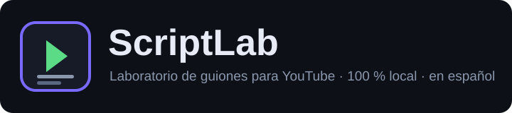

<p align="center">
  
</p>

# ScriptLab

**Laboratorio de guiones para YouTube** — medí la salud (ICN), la retención estimada (APV) y el arco emocional de tu guion *antes de grabar*. Todo corre **100 % en tu navegador**: la heurística al instante y la IA con modelos locales (~110 MB, se descargan una vez y quedan en tu dispositivo). Sin cuentas, sin servidores, sin tracking.

    

---

## Inicio rápido

| Destino | Archivo |
|---|---|
| 🚀 **Abrir la app** | [`scriptlab.html`](./scriptlab.html) |
| 🌐 Landing | [`index.html`](./index.html) |
| 📐 Fórmulas y fuentes (web) | [`metricas.html`](./metricas.html) |

Para correrla en local necesitá servir la carpeta (los módulos ES y los workers no funcionan con `file://` en Chrome):

```bash
cd scriptlab
python3 -m http.server 8000
# → http://localhost:8000/scriptlab.html
```

La **IA es opcional**: el modo heurístico ya te da Salud, APV, curva, factores y carga cognitiva. Activando el *Modo IA* (⚙) se descargan embeddings multilingüe + sentimiento español (robertuito) que corren localmente en Web Workers.

## Estructura del repositorio

```
├── index.html          # landing (comparativa con competidores incluida)
├── scriptlab.html      # la app
├── metricas.html       # desglose de pesos, fórmulas y fuentes (con links)
├── css/
│   └── styles.css
├── js/
│   ├── main.js             # orquestación UI
│   ├── render.js           # todo el DOM
│   ├── workers.js          # ciclo de vida de workers (IA / retención / sentimiento)
│   ├── export-import.js    # exportadores JSON/MD/TXT/CSV/HTML/PDF + import
│   ├── db.js               # IndexedDB
│   ├── diagnostics.js      # utilidades de diagnóstico
│   ├── scoring.js          # ⚠ ICN (Salud del guion) — lógica pura
│   ├── retention-engine.js # ⚠ APV, curva, factores, arco→APV, carga cognitiva — lógica pura
│   ├── sentiment-engine.js # ⚠ arco emocional (chunking, missing ≠ 0) — lógica pura
│   ├── ai-shared.js        # ⚠ sílabas RAE, Fernández-Huerta, sanitizers — lógica pura
│   ├── state.js            # estado global, ENGINE_VERSION, HEURISTICS
│   └── {ai,sentiment,retention}-worker.js  # wrappers de workers
├── sw.js               # Service Worker (shell offline, network-first)
├── tests/
│   ├── run-tests.mjs           # 94 tests (node tests/run-tests.mjs)
│   ├── run-benchmark-paso2.mjs # benchmark arena/mimo/combined con 4 guiones
│   └── e2e/                  # drivers de navegador real (puppeteer) + fixtures
└── docs/
    ├── SCRIPT-LAB-METRICAS-Y-FUENTES.md   # contrato de métricas y fuentes
    ├── CHANGELOG-COMBINED.md              # historia de merge + decisiones (PASO 1-3)
    ├── RESEARCH-PASO3.md                  # validación de pesos con literatura
    ├── BENCHMARK-PASO2.md                 # benchmark 4 guiones × 3 builds
    ├── analisis-motores-scriptlab.md      # auditoría 1 (arena vs mimo)
    └── auditoria-arco-emocional.md        # auditoría 2 (ruta del arco)
```

> **⚠ Regla de oro:** los 4 módulos del motor de diagnóstico (`js/scoring.js`, `js/retention-engine.js`, `js/sentiment-engine.js`, `js/ai-shared.js`) son lógica pura sellada con 94 tests. No los modifiques sin correr la suite antes y después.

## Qué mide

**Salud del guion (ICN, 0-100):** `hook×0.31 + claridad×0.22 + ritmo×0.22 + promesa×0.17 + 8×(calidadCTA/100)` — el bonus de CTA está **escalado** (estudio Wistia: mid-roll 16.95 % vs post-roll 10.98 %; lo que importa es el placement, no la presencia).

**Retención estimada (APV, 15-95 %):** suma ponderada de 9 factores — hook 0.25 · pacing 0.17 · pattern interrupts 0.14 · **arco emocional 0.11** · densidad 0.11 · promesa 0.09 · legibilidad 0.07 · CTA 0.03 · narrativa 0.03. El arco entra solo cuando hay análisis IA disponible (si no, N/D y renormalización). Fórmula completa **auditable mano a mano** en la propia app y en cada export.

**Arco emocional (IA local):** valencia por bloque (robertuito), engagement, momentum y saltos tonales. Los flips de emocionalidad alimentan el APV (Berger et al. 2026, JAMS/Springer — efecto causal; Song et al. 2023, eNeuro).

Desglose completo con citas: **[`metricas.html`](./metricas.html)** · versión markdown: [`docs/SCRIPT-LAB-METRICAS-Y-FUENTES.md`](./docs/SCRIPT-LAB-METRICAS-Y-FUENTES.md).

## Exportaciones

Guion: **JSON · HTML (onepage autocontenida con las mismas gráficas de la app) · Markdown · TXT · CSV · PDF**. Diagnóstico: **JSON · TXT · CSV · HTML · PDF**.

## Desarrollo

```bash
npm test           # = node tests/run-tests.mjs          → 94/94
npm start          # = python3 -m http.server 8000
npm run benchmark  # = node tests/run-benchmark-paso2.mjs (local-only, ver nota)
```

> `npm run benchmark` compara contra las builds de referencia `arena`/`mimo`
> y los 4 guiones originales, que **no se publican** en el repo: corre solo
> en local, no en CI.

Sin dependencias de build: vanilla JS + CSS + Web Workers + Transformers.js (CDN, solo en Modo IA).
El **CI** (GitHub Actions, Node 20 y 22) corre la suite principal en cada push y PR (`tests.yml`); el E2E en navegador real es manual (`e2e.yml`).

### Verificación E2E (navegador real)

```bash
cd tests/e2e
npm init -y && npm i puppeteer-core @puppeteer/browsers
npx @puppeteer/browsers install chrome-headless-shell@stable --path ~/.cache/puppeteer
cd ../.. && python3 -m http.server 8123 --bind 127.0.0.1 &
cd tests/e2e && node drive.mjs && node drive-ia.mjs
```

Chromium headless real (+ los 2 modelos IA de verdad en `drive-ia.mjs`).
Resultado V1.0.0a: **TODO OK (28/28 + 9/9)** — reporte y capturas:
[`docs/PRUEBAS-E2E-V1.0.0a.md`](./docs/PRUEBAS-E2E-V1.0.0a.md) · instrucciones: [`tests/e2e/README.md`](./tests/e2e/README.md).

## Procedencia

Build `combined` auditada de dos builds previas (`arena`, `mimo`): motor mimo como base, rescates de arena (sílabas ≈RAE, sanitizers, chunking, modo-IA honesto), todos los bugs corregidos, y pesos calibrados/validados con literatura en el PASO 3. Historia completa en [`docs/CHANGELOG-COMBINED.md`](./docs/CHANGELOG-COMBINED.md).

## Release actual

**V1.0.0a** (22 jul 2026) — primera release pública. Notas: [`docs/releases/v1.0.0a.md`](./docs/releases/v1.0.0a.md) · historial: [`CHANGELOG.md`](./CHANGELOG.md).

## Comunidad y gobernanza

- [`CONTRIBUTING.md`](./CONTRIBUTING.md) — cómo contribuir (regla de oro del motor + estándar de evidencia para tocar pesos)
- [`SECURITY.md`](./SECURITY.md) — reporte de vulnerabilidades
- [`CODE_OF_CONDUCT.md`](./CODE_OF_CONDUCT.md) — Contributor Covenant 2.1 (español)
- [`CHANGELOG.md`](./CHANGELOG.md) — historial de cambios

## Licencia

[MIT](./LICENSE) © 2026 ScriptLab Contributors.
